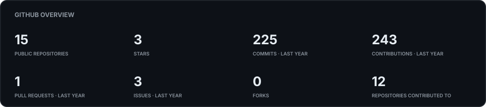
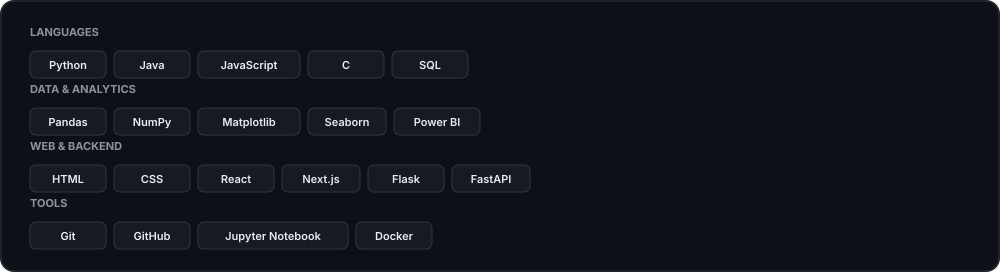
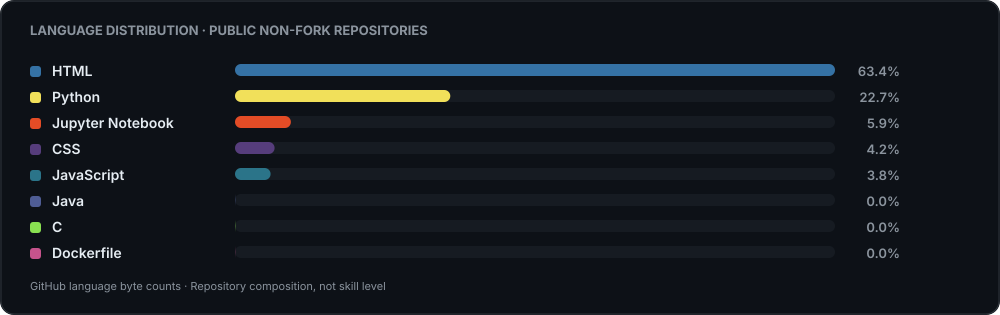
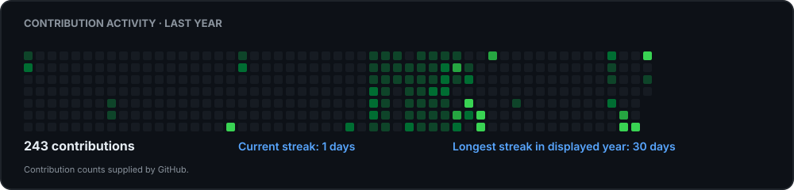

<h1 align="center">Syed Mohammad Hamzah</h1>

  <strong>Computer Science Undergraduate</strong> 
  Data Science · Artificial Intelligence · Software Development

  <a href="https://github.com/syedhamzah-dev">GitHub</a> ·
  <a href="https://www.linkedin.com/in/syedmohdhamzah/">LinkedIn</a> ·
  <a href="https://beyond-the-algorithm-sable.vercel.app/">Beyond the Algorithm</a>

---

## 👋 About Me

- 🎓 B.Tech Computer Science and Engineering student at Integral University.
- 📊 Exploring Data Science, analytics, and data-driven problem solving.
- 🤖 Learning Machine Learning and Artificial Intelligence.
- 🛠️ Building software, dashboards, and practical experiments.
- ✍️ Writing about technology and my learning process at [Beyond the Algorithm](https://beyond-the-algorithm-sable.vercel.app/).

## 🌐 Connect With Me

  
  
  

## 📊 GitHub Statistics

  

## 💻 Tech Stack

  

## 🧩 Language Distribution

  

Language percentages are calculated from GitHub repository language byte counts. They describe code composition, not personal proficiency.

## 🔥 Contribution Activity

  

---

## 🚀 Featured Projects

<table>
  <tr>
    <td width="50%" valign="top">
      <h3><a href="https://github.com/syedhamzah-dev/election-campaign-analysis">Election Campaign Analyzer (2004–2024)</a></h3>
      
Data science pipeline and Streamlit dashboard exploring five Indian Lok Sabha election cycles, with electoral metrics and visual analysis.

      
Python · Pandas · NumPy · Matplotlib · Seaborn · Streamlit

      
<a href="https://election-analyzer.streamlit.app/">Live Dashboard</a>

      
Portfolio-listed recognition: Best Project, Data Science In-house Internship/Training at Sipher Web Pvt. Ltd.

    </td>
    <td width="50%" valign="top">
      <h3><a href="https://github.com/syedhamzah-dev/Claude-AI-Challenge">Healthcare Efficiency Explorer</a></h3>
      
Interactive analysis of healthcare expenditure and life expectancy across approximately 193 countries using World Bank data.

      
Python · Streamlit · Pandas · Plotly · pytest

      
<a href="https://healthcare-efficiency-explorer.streamlit.app/">Live Dashboard</a>

    </td>
  </tr>
  <tr>
    <td width="50%" valign="top">
      <h3><a href="https://github.com/syedhamzah-dev/resourcebridge">ResourceBridge</a></h3>
      
Campus resource-sharing application built around resource discovery, booking, manager approvals, check-in, returns, and incident tracking.

      
Python · Flask · HTML · CSS · JavaScript

    </td>
    <td width="50%" valign="top">
      <h3><a href="https://github.com/syedhamzah-dev/autonomous-ai-creator">Autonomous AI Creator</a></h3>
      
AI workflow for discovering technology topics, checking relevance, reducing repetition, and generating source-grounded content.

      
Python · FastAPI · AsyncIO

    </td>
  </tr>
  <tr>
    <td width="50%" valign="top">
      <h3><a href="https://github.com/syedhamzah-dev/customer_behaviour_analysis">Customer Behaviour Analysis</a></h3>
      
Retail analysis combining Python preprocessing, MySQL aggregation, and an interactive Power BI dashboard.

      
Python · Pandas · MySQL · Power BI

    </td>
    <td width="50%" valign="top">
      <h3><a href="https://github.com/syedhamzah-dev/gurgaon-real-estate-analysis">Gurgaon Real Estate Analysis</a></h3>
      
Exploratory analysis of property listings, locality patterns, pricing drivers, and property valuation.

      
Python · Pandas · NumPy · Matplotlib · Seaborn

    </td>
  </tr>
  <tr>
    <td width="50%" valign="top">
      <h3><a href="https://github.com/syedhamzah-dev/engineering-journal">Beyond the Algorithm</a></h3>
      
Independent technology publication documenting concepts, projects, experiments, and learning in Data Science, AI, ML, and software engineering.

      
Next.js · React · JavaScript · CSS

      
<a href="https://beyond-the-algorithm-sable.vercel.app/">Visit Publication</a>

    </td>
    <td width="50%" valign="top">
      <h3><a href="https://github.com/syedhamzah-dev/portfolio">Personal Portfolio</a></h3>
      
Personal website presenting projects, certifications, and professional background.

      
HTML · CSS · JavaScript

    </td>
  </tr>
</table>

## 🧪 More Projects & Experiments

- [Expense Tracker](https://github.com/syedhamzah-dev/Expense_Tracker)
- [Notes Maker](https://github.com/syedhamzah-dev/Notes-Maker)
- [Simple Calculator in C](https://github.com/syedhamzah-dev/Simple-Calculator-in-C)
- [Marks Calculator](https://github.com/syedhamzah-dev/Marks-Calculator)
- [Claude AI Challenge](https://github.com/syedhamzah-dev/Claude-AI-Challenge)
- [DemoRepo](https://github.com/syedhamzah-dev/DemoRepo)
- [localRepo](https://github.com/syedhamzah-dev/localRepo)
- [Desktop Tutorial](https://github.com/syedhamzah-dev/desktop-tutorial)

[Browse all repositories →](https://github.com/syedhamzah-dev?tab=repositories)

---

  <em>Learning continuously. Building thoughtfully. Exploring beyond the algorithm.</em>

  Statistics and language charts are generated and refreshed automatically by GitHub Actions.

