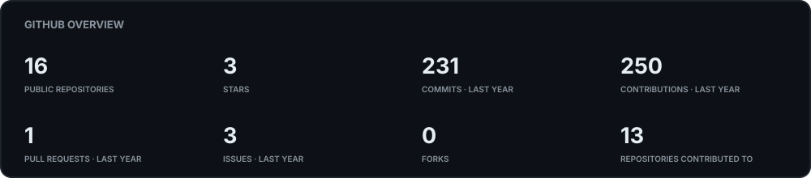
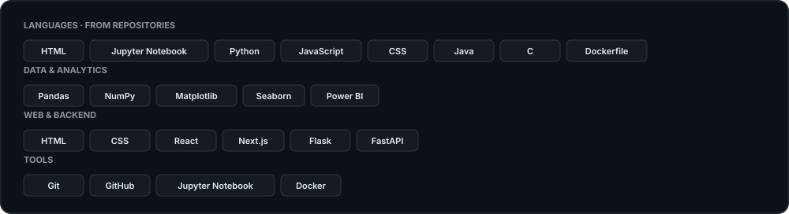
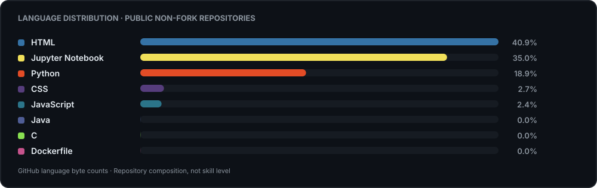
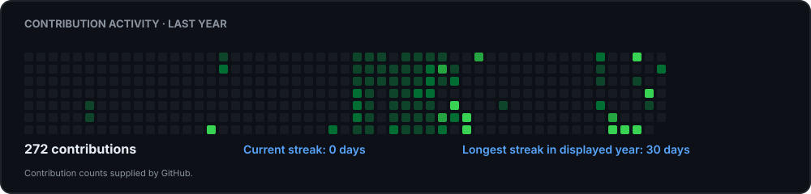

<h1 align="center">Syed Mohammad Hamzah</h1>

  <strong>Computer Science Undergraduate</strong> 
  Data Science · Artificial Intelligence · Software Development

  <a href="https://github.com/syedhamzah-dev">GitHub</a> ·
  <a href="https://www.linkedin.com/in/syedmohdhamzah/">LinkedIn</a> ·
  <a href="https://beyond-the-algorithm-sable.vercel.app/">Beyond the Algorithm</a>

---

## 👋 About Me

- 🎓 B.Tech Computer Science and Engineering student at Integral University.
- 📊 Exploring Data Science, analytics, and data-driven problem solving.
- 🤖 Learning Machine Learning and Artificial Intelligence.
- 🛠️ Building software, dashboards, and practical experiments.
- ✍️ Writing about technology and my learning process at [Beyond the Algorithm](https://beyond-the-algorithm-sable.vercel.app/).

## 🌐 Connect With Me

  
  
  

## 📊 GitHub Statistics

  

## 💻 Tech Stack

  

## 🧩 Language Distribution

  

Language percentages are calculated from GitHub repository language byte counts. They describe code composition, not personal proficiency.

## 🔥 Contribution Activity

  

---

## 🚀 Featured Projects

<!-- AUTO-FEATURED-PROJECTS-START -->
<table>
<tr><td width="50%" valign="top"><h3><a href="https://github.com/syedhamzah-dev/election-campaign-analysis">Election Campaign Analyzer (2004–2024)</a></h3>
An interactive data analytics dashboard exploring 20 years of Indian Lok Sabha election results (2004–2024) using Python, Pandas, NumPy, Matplotlib, Seaborn, and Streamlit.

Python · ⭐ 1

<a href="https://election-analyzer.streamlit.app/">Live project / publication</a>
</td><td width="50%" valign="top"><h3><a href="https://github.com/syedhamzah-dev/Claude-AI-Challenge">Healthcare Efficiency Explorer</a></h3>
A 60-day hands-on learning challenge exploring Claude AI, AI-powered development, prompt engineering, and practical AI applications through daily experiments and projects.

HTML · ⭐ 0

<a href="https://healthcare-efficiency-explorer.streamlit.app/">Live project / publication</a>
</td></tr>
<tr><td width="50%" valign="top"><h3><a href="https://github.com/syedhamzah-dev/resourcebridge">ResourceBridge</a></h3>
A campus resource-sharing platform that helps students discover and request underused equipment and spaces, with eligibility checks, owner approvals, fair access, condition tracking, and an auditable booking history.

Python · ⭐ 1
</td><td width="50%" valign="top"><h3><a href="https://github.com/syedhamzah-dev/autonomous-ai-creator">Autonomous AI Creator</a></h3>
AI workflow for discovering technology topics, checking relevance, reducing repetition, and generating source-grounded content.

Python · ⭐ 0
</td></tr>
<tr><td width="50%" valign="top"><h3><a href="https://github.com/syedhamzah-dev/customer_behaviour_analysis">Customer Behaviour Analysis</a></h3>
Customer shopping behaviour analysis using Python, SQL, and Power BI to uncover purchasing patterns, revenue insights, and product performance.

Jupyter Notebook · ⭐ 0
</td><td width="50%" valign="top"><h3><a href="https://github.com/syedhamzah-dev/gurgaon-real-estate-analysis">Gurgaon Real Estate Analysis</a></h3>
Real estate data cleaning, analysis and visualization using Python

Jupyter Notebook · ⭐ 0
</td></tr>
<tr><td width="50%" valign="top"><h3><a href="https://github.com/syedhamzah-dev/engineering-journal">Beyond the Algorithm</a></h3>
Documenting my journey from an engineering student to the world of Data Science, AI, and Machine Learning.

JavaScript · ⭐ 0

<a href="https://beyond-the-algorithm-sable.vercel.app/">Live project / publication</a>
</td><td width="50%" valign="top"><h3><a href="https://github.com/syedhamzah-dev/portfolio">Personal Portfolio</a></h3>
Personal website presenting projects, certifications, and professional background.

CSS · ⭐ 0
</td></tr>
</table>
<!-- AUTO-FEATURED-PROJECTS-END -->

## 🧪 More Projects & Experiments

<!-- AUTO-MORE-PROJECTS-START -->
- [super__rr__selection](https://github.com/syedhamzah-dev/super__rr__selection) — Data-driven cricket analytics system to identify and rank IPL and T20I batters and bowlers based on their performance under high-pressure match situations using Python, statistical analysis, and interactive visualizations. · Jupyter Notebook · ⭐ 0
- [my_repo](https://github.com/syedhamzah-dev/my_repo) · HTML · ⭐ 0
- [Marks-Calculator](https://github.com/syedhamzah-dev/Marks-Calculator) · Java · ⭐ 0
- [Simple-Calculator-in-C](https://github.com/syedhamzah-dev/Simple-Calculator-in-C) · C · ⭐ 0
- [Expense_Tracker](https://github.com/syedhamzah-dev/Expense_Tracker) · Python · ⭐ 0
- [Notes-Maker](https://github.com/syedhamzah-dev/Notes-Maker) · CSS · ⭐ 0
<!-- AUTO-MORE-PROJECTS-END -->

[Browse all repositories →](https://github.com/syedhamzah-dev?tab=repositories)

---

  <em>Learning continuously. Building thoughtfully. Exploring beyond the algorithm.</em>

  Statistics and language charts are generated and refreshed automatically by GitHub Actions.

